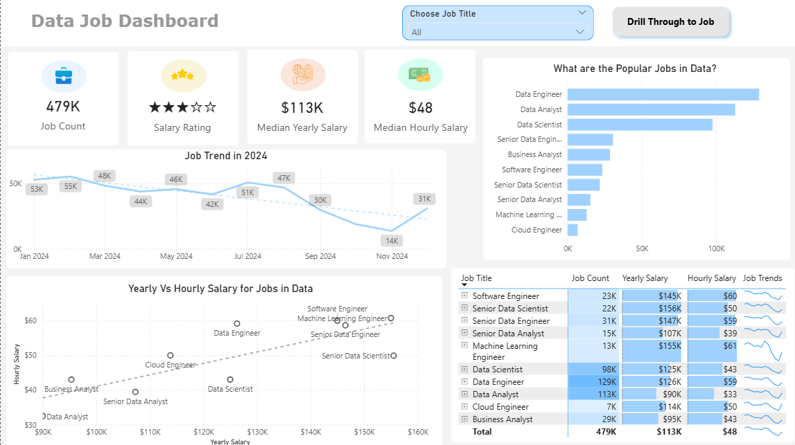
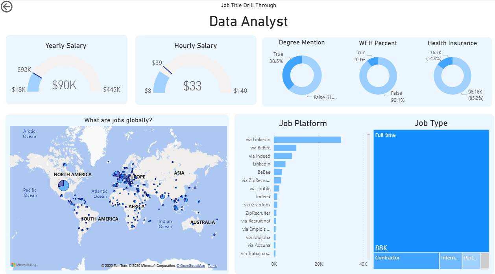

# Data Jobs Dashboard w/ Power Bi
		

[View interactive dashboard here on the Power BI service](Data_Jobs_Dashboard.pbix)
## Introduction

This dashboard was created for **job seekers, career transitioners, and anyone exploring opportunities in the data field** . It addresses a common challenge: information about the data job market is often scattered and difficult to understand. Using a real-world 2024 dataset of Data Science job postings, including job titles, salaries, and locations, this project provides a single, easy-to-use interface to explore market trends and compensation. 

## Skills Showcased

- ⚙️ Data Transformation (ETL) with Power Query: Cleaned, shaped, and prepared the raw data for analysis by handling blanks, changing data types, and creating new columns.

- 🧮 Implicit Measures: Formulated measures to derive key insights and KPIs like Median Yearly Salary and Job Count.

- 📊 Core Charts: Utilized Column, Bar, Line, and Area Charts to compare job counts and track trends over time.

- 🗺️ Geospatial Analysis: Leveraged Map Charts to visualize the global distribution of jobs.

- 🔢 KPI Indicators & Tables: Used Cards to display key metrics and Tables to provide granular, sortable data.

- 🎨 Dashboard Design: Designed an intuitive and visually appealing layout, exploring both common and uncommon chart types to best tell the data story.

- 🖱️ Interactive Reporting:
    - Slicers: To dynamically filter the report by Job Title.
    - Buttons & Bookmarks: To create a seamless navigation experience.
    - Drill-Through: To navigate from a high-level summary to a contextual, detailed view.

## Dashboard Overview

### Page 1: High Level Market View

This page provides an overview of the data job market through key performance indicators (KPIs) and visualizations. It highlights important metrics such as total job postings, average job ratings, median yearly salaries, and median hourly salaries.
Users can explore job market trends over time, compare hourly and yearly salaries across different job titles, and identify the most in-demand positions through interactive charts and tables.

### Page 2 : Job Title Drill Through

This page provides a more detailed analysis of individual job titles. Users can select a specific role from the main dashboard and drill through to explore relevant information.
The detailed view includes salary ranges, work-from-home opportunities, popular hiring platforms, and the geographical distribution of job opportunities

## Conclusion
This project demonstrates how Power BI can transform raw job posting data into meaningful insights through interactive dashboards and visual storytelling.
By combining key performance indicators, data visualizations, and drill-through functionality, the dashboard allows users to explore employment trends, compare salaries, and better understand opportunities within the data industry.
Ultimately, this project highlights the value of data analytics in supporting informed career planning and decision-making.
